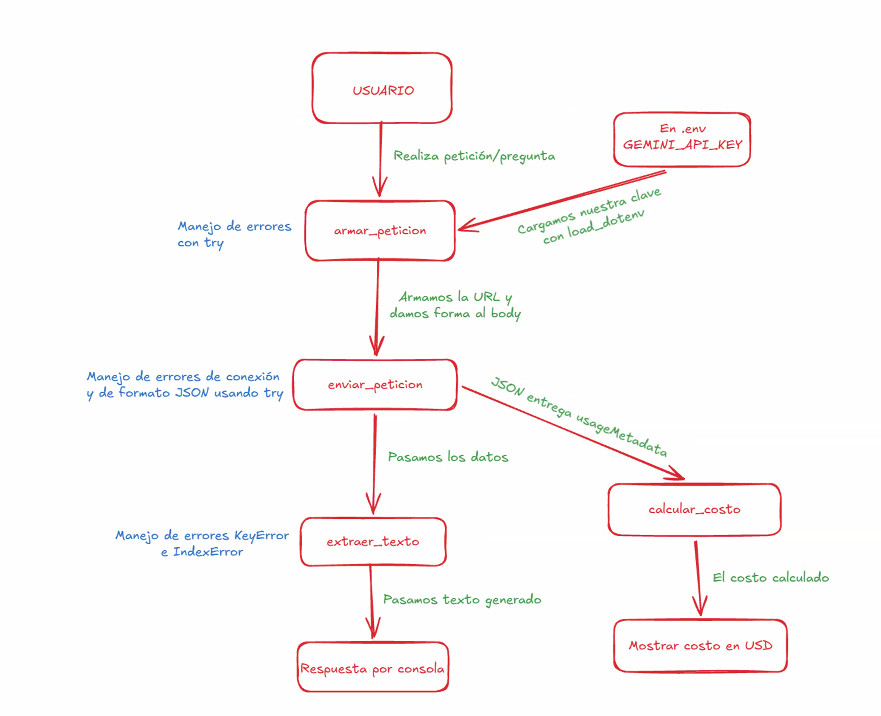

# Decisión de arquitectura: elección de modelo
  
## Modelo elegido
El modelo elegido es **gemini 3.5 flash lite** para la funcionalidad principal de la miniaplicación.
  
## Diagrama de arquitectura

  
## Comparación de candidatos
| Criterio | 3.6 flash | 3.1 flash lite | 3.5 flash lite |
| :--- | :--- | :--- | :--- |
| **Costo de 4 intentos** | $0.008230 USD | $0.000523 USD | $0.000775 USD |
| **Latencia promedio** | 5.73 segundos | 9.22 segundos | 2.02 segundos |
| **Calidad de respuesta** | Ofrece respuestas elaboradas y contextuales. | Listados limpios y lenguaje directo. | Lenguaje directo y respuestas cortas. |
  
## Justificación
El modelo gemini 3.5 flash lite resulta el punto de equilibrio perfecto entre los tres modelos testeados. Es el más rápido, mantiene un costo extremadamente bajo con rendimiento predecible y la calidad de su estructura es más que suficiente para el proyecto planteado. Este modelo entrega listados limpios, viñetas claras y un tono profesional directo al grano, ideal para el chat diario, la generación rápida de ideas, etiquetas SEO y estructuras de guiones.
  
## Alternativa descartada y por qué
Gemini 3.1 flash lite es el más económico, pero su latencia es inaceptable para una aplicación de usuario final, que podría arruinar la experiencia de usuario.  
Gemini 3.6 flash ofrece respuestas muy ricas y contextuales, pero es casi 10 veces más caro que las versiones lite y su latencia se acerca a los 6 segundos, lo que puede ser lento en una interfaz interactiva.
